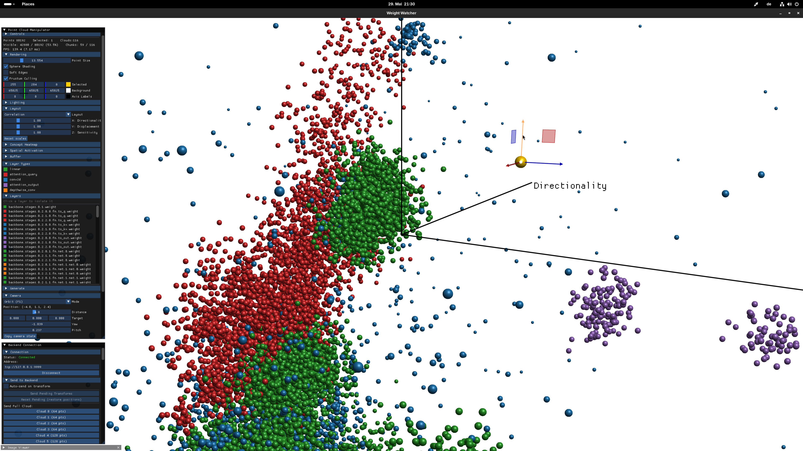
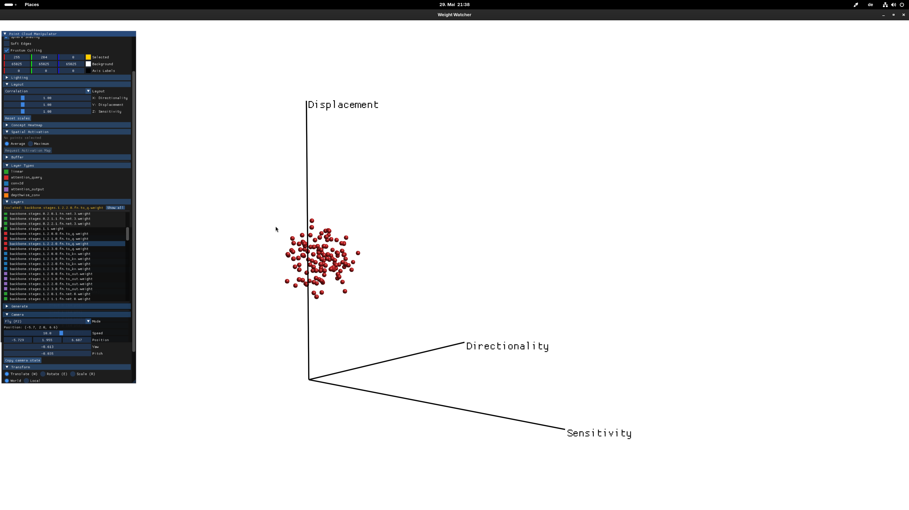

# Weight Watcher

Interactive 3D exploration of neural network weight trajectories.
 
This is the code for our BMVC 2026 paper *Geometric Signatures of Neural Networks through Invertible Weight Trajectory Decomposition*. 

Weight Watcher is a research tool for exploring neural-network weights in 3D and testing how changes to those weights affect a model's behavior. It combines a C++/OpenGL viewer ("Manipulator") with a Python/PyTorch backend ("Inference Engine"). The idea is to treat computational parts of layers of a network (e.g. convolutional filters, linear-layer rows, or attention components) as points, also known as Semantic Units, in a low-dimensional space. You can inspect the resulting point clouds, select and move the Semantic Units, and send those changes back to the backend for reconstruction and evaluation. We effectively change the weights of layers.

While the frontend can technically run on its own, for the full workflow, you will need your own model checkpoints, datasets, and projection files, along with the Python backend.




## Manipulator (Frontend, Client)

### Requirements
(only if you build it yourself; see the AppImage below)
- Linux (X11 or Wayland). Other platforms may work but aren't tested.
- A GPU and driver with OpenGL 4.6 core profile
- CMake 3.16+, a C++20 compiler (GCC 11+ or Clang 14+).
- Git and internet access at configure time: GLFW, GLM, Dear ImGui, ImGuizmo and nng are fetched by CMake

GLFW needs the X11 and Wayland headers. On Debian/Ubuntu:
 
```bash
sudo apt install build-essential cmake ninja-build git \
    libx11-dev libxrandr-dev libxinerama-dev libxcursor-dev libxi-dev \
    libwayland-dev wayland-protocols libxkbcommon-dev libgl-dev
```

### Option A: AppImage (Linux, no build needed)
 
Download `WeightWatcher-x86_64.AppImage` from the [Releases](../../releases) page, then:
 
```bash
chmod +x WeightWatcher-x86_64.AppImage
./WeightWatcher-x86_64.AppImage
```
 
The AppImage bundles everything except the GPU driver, so you still need OpenGL 4.6. It needs glibc 2.39 or newer (Ubuntu 24.04, Debian 13, Fedora 40 and later). If it complains about FUSE, install `libfuse2` (`libfuse2t64` on Ubuntu 24.04+) or run it via `--appimage-extract-and-run`.
 
### Option B: Build from source
 
```bash
cd manipulator
cmake -B build -DCMAKE_BUILD_TYPE=Release
cmake --build build
./build/WeightWatcher_Manipulator
```
 
The first configure takes a while because it downloads the dependencies (they are local, nothing is installed system-wide). To build the AppImage yourself, run `./packaging/build_appimage.sh`. It writes `WeightWatcher-x86_64.AppImage` into `manipulator/`.


### Credits
The manipulator (frontend) is built on [GLFW](https://www.glfw.org), [GLM](https://github.com/g-truc/glm), [Dear ImGui](https://github.com/ocornut/imgui), [ImGuizmo](https://github.com/CedricGuillemet/ImGuizmo), [nng](https://github.com/nanomsg/nng) and [glad](https://github.com/Dav1dde/glad).

## Inference Engine (Backend, Server)

### Requirements
- Python 3.10+
- A CUDA GPU is **strongly** recommended. `--device cpu` works, just slowly.

### Installation
Install PyTorch for your CUDA version first (see [pytorch.org](https://pytorch.org/get-started/locally/)), then the rest:
 
```bash
cd inference_engine
python -m venv .venv
source .venv/bin/activate
pip install -e .
```
This installs everything in `requirements.txt` and makes `models`, `inference`, `projections` and `trainer.common` importable from anywhere, which the analysis scripts rely on.


## Usage
 
### 1. Prepare checkpoints
 
You need one checkpoint per epoch of a training run, plus the final model, laid out like this:
 
```
checkpoints/imagenet100_mit_b2/
  epochs/   epoch_0000.pth ... epoch_0299.pth
  best/     best.pth
```
 
Each file holds the model's state dict, either directly or under one of the keys `model_state`, `state_dict`, `model` or `model_state_dict`. Supported datasets: `imagenet100`, `isic2019` (classification), `voc2012_sbd`, `isic2018` (segmentation). The expected folder layout for each is described at the top of `trainer/common/datasets.py`. Supported backbones: ConvNeXt V2 Base, CycleMLP B2 and MiT B2.
 
### 2. Project the trajectories
 
```bash
cd inference_engine/projections
python projection.py pca \
    -i /path/to/checkpoints/imagenet100_mit_b2/epochs \
    -m /path/to/checkpoints/imagenet100_mit_b2/best/best.pth \
    -c ../configs/decomposition/mit_b2_classification.yaml \
    -o ./out/imagenet100_mit_b2_pca \
    -k 3 --device cuda
```
 
Replace `pca` with `umap` or `fourier_kpca` for the other methods. Both run on CPU only, and UMAP needs `--num_workers 1`. The output folder contains `<model>_decomposers.pt` and `<model>_projected.pt`.
 
### 3. Start the backend, then the viewer
 
```bash
cd inference_engine
python main.py classification \
    --backbone mit --variant b2 --num_classes 100 \
    --dataset imagenet100 --data_root /path/to/imagenet100 \
    --checkpoint_path  /path/to/best/best.pth \
    --decomposers_path projections/out/imagenet100_mit_b2_pca/mit_b2_classification_decomposers.pt \
    --projection_path  projections/out/imagenet100_mit_b2_pca/mit_b2_classification_projected.pt \
    --val_transforms   configs/transform/imagenet100_val.yaml \
    --anchor_size 300 --batch_size 16
```
 
The backend listens on `tcp://*:9999` (change with `-a`). `--anchor_size` is the number of validation images used for predictions, activation maps and the concept heatmap. The heatmap needs at least 2 images per class, so use at least twice the number of classes; 5 per class gives cleaner results. Optional `--trajectory_geometry_csv`, `--sensitivity_csv` and `--variance_explained_csv` enable the extra layouts in the viewer; they are produced by the scripts in `analysis/`.
 
Then start the viewer and connect to `tcp://localhost:9999` from the connection panel. While the backend is working on a request, the affected panel shows a spinner. You can pass a session file as the first argument to restore camera, layout and window size:
 
```bash
./build/WeightWatcher_Manipulator my_session.txt
./WeightWatcher-x86_64.AppImage my_session.txt   # same with the AppImage
```
 
**Backend on a remote machine:** forward the port and connect to localhost as usual.
 
```bash
ssh -L 9999:localhost:9999 gpu-server
```
 
### Controls
 
| Input | Action |
|---|---|
| Left-click | Select |
| Shift+click / Ctrl+click | Add to selection / toggle |
| Alt+right-drag | Box select |
| Middle-drag or Alt+left-drag | Orbit |
| Shift+middle-drag | Pan |
| Scroll | Zoom |
| W / E / R | Translate / rotate / scale gizmo |
| Ctrl+A / Ctrl+I / Esc | Select all / invert / clear |
| Ctrl+Z / Ctrl+Y | Undo / redo |
| F1 / F2 | Orbit / fly camera |
| WASD, Space, Ctrl, Shift | Fly: move, up, down, sprint (right-drag to look) |
 
## Troubleshooting
 
- **`Failed to find wayland-scanner` during configure:** install `libwayland-dev` and `wayland-protocols`.
- **Viewer exits right after start, or GLAD init fails:** your driver doesn't provide OpenGL 4.6. `glxinfo -B` shows what you have.
- **Viewer doesn't receive anything:** check that the backend is running and that nothing else is using port 9999.
- **Concept heatmap is a single color:** `--anchor_size` is too small for the number of classes. Use at least twice the number of classes.
- **`ModuleNotFoundError: models` (or `inference`, `projections`) in analysis scripts:** you skipped `pip install -e .`.

## Experiment Artifacts

The model checkpoints, experiment results (as generated by the analysis scripts), logs and projection files can all be found in the HuggingFace repository: <https://huggingface.co/buckets/hudo259/experiment_artifacts_weight-watcher>
The folder layout there corresponds to the folder layout found in the folder "data". Just put the files there.

## Citation
 
```bibtex
@inproceedings{hudcovic2026bmvc,
author    = {Hudcovic, Thomas and Zachmann, Gabriel},
title     = {Geometric Signatures of Neural Networks through Invertible Weight Trajectory Decomposition},
booktitle = {37th British Machine Vision Conference 2026, {BMVC} 2026, Lancaster, UK, November 23-26, 2026},
publisher = {BMVA},
year      = {2026},
url       = {https://bmvc2026.bmva.org/proceedings/papers/paper_00514/}
}
```

## License

Weight Watcher is licensed under the [EUPL-1.2](LICENSE). Files adapted from
other projects keep their original licenses (MIT or Apache-2.0), stated in
each file's header. License texts are in `LICENSES/`.

